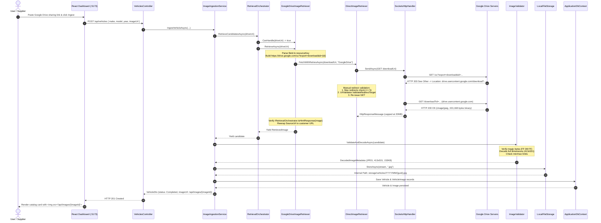

# 07 — Google Drive Image Retrieval Service & Flow Reference

This document provides a comprehensive technical breakdown of the **Google Drive Public Image Retrieval** subsystem in the Vehicle Image System (`VehicleImage.Api`). It details the problem, architecture, component design, sequence flow, security controls, error handling, edge cases, and interview defense questions.

---

## 1. Problem Statement & Background

### 1.1 The Customer Scenario
A customer or vehicle supplier stores vehicle photos in Google Drive, sets file permissions to **"Anyone with the link can view"**, and pastes the link into our system:
```text
https://drive.google.com/file/d/1Y7xhUt-X-Frjt-gHtPXt7BEQL5101O7e/view?usp=sharing
```

### 1.2 Why the Standard Pipeline Fails Without a Dedicated Retriever
When an HTTP `GET` request is issued to that URL:
1. Google Drive returns HTTP `200 OK` with `Content-Type: text/html; charset=utf-8` (~84 KB).
2. The HTML is a single-page JavaScript application (Google Drive Viewer) containing `<title>filename.jpg - Google Drive</title>`.
3. It contains **zero** `og:image` or `twitter:image` metadata tags, and **zero** `` tags representing the vehicle photo. The photo is loaded dynamically via JavaScript and canvas rendering.
4. When passed to `HtmlImageRetriever`, candidate extraction finds zero candidates and throws `NO_IMAGE_FOUND`.

### 1.3 The Solution Architecture
Instead of running expensive, fragile headless browsers (e.g., Puppeteer/Playwright) or requiring complex customer Google OAuth setup, the system implements a dedicated `GoogleDriveImageRetriever` that translates public Google Drive URLs directly into high-throughput binary download streams through the existing URL-validated retrieval pipeline.

---

## 2. Component Architecture

```
                       ┌─────────────────────────────────────────┐
                       │           VehiclesController            │
                       │    POST /api/vehicles (or /import)      │
                       └────────────────────┬────────────────────┘
                                            │
                                            ▼
                               ┌─────────────────────────┐
                               │  ImageIngestionService  │
                               └────────────┬────────────┘
                                            │
                                            ▼
                               ┌─────────────────────────┐
                               │      UrlValidator       │
                               │ (Scheme/Port/Loopback)  │
                               └────────────┬────────────┘
                                            │
                                            ▼
                               ┌─────────────────────────┐
                        ┌─────►│  RetrievalOrchestrator  │
                        │      └────────────┬────────────┘
                        │                   │
                        │       CanHandle?  ├────────────────────────────┐
                        │                   │ (Matches Drive hosts)       │ (Other URLs)
                        │                   ▼                             ▼
                        │      ┌─────────────────────────┐   ┌────────────────────────┐
                        │      │ GoogleDriveImageRetriever│   │  DirectImageRetriever  │
                        │      └────────────┬────────────┘   └───────────┬────────────┘
                        │                   │                            │
                        │                   │ (Executes download GET     │
                        │                   │  via DirectRetriever)      │
                        │                   ▼                            │
                        │      ┌─────────────────────────┐               │
                        │      │  DirectImageRetriever   │◄──────────────┘
                        │      │  (SocketsHttpHandler)   │
                        │      └────────────┬────────────┘
                        │                   │ (If non-Drive redirected
                        │                   │  to Drive, returns here)
                        │                   ▼
                        │      ┌─────────────────────────┐
                        │      │     ImageValidator      │
                        │      │  (Magic bytes, decode,  │
                        │      │   dimension limits)     │
                        │      └────────────┬────────────┘
                        │                   │
                        │                   ▼
                        │      ┌─────────────────────────┐
                        │      │    LocalFileStorage     │
                        │      │ (storage/vehicles/...)  │
                        │      └────────────┬────────────┘
                        │                   │
                        │                   ▼
                        │      ┌─────────────────────────┐
                        │      │  ApplicationDbContext   │
                        │      │  (Persist Vehicle+Image)│
                        │      └─────────────────────────┘
```

---

## 3. URL Translation & Pattern Recognition

`GoogleDriveImageRetriever.CanHandle(Uri uri)` intercepts the following domains:
- `drive.google.com`
- `drive.usercontent.google.com`
- `docs.google.com`

### 3.1 Accepted URL Formats
| Input Format | Sample | Extracted Target |
| :--- | :--- | :--- |
| **Standard Sharing URL** | `https://drive.google.com/file/d/{FILE_ID}/view?usp=sharing` | `fileId = {FILE_ID}` |
| **Multi-account URL** | `https://drive.google.com/file/u/0/d/{FILE_ID}/view` | `fileId = {FILE_ID}` |
| **Open Endpoint** | `https://drive.google.com/open?id={FILE_ID}` | `fileId = {FILE_ID}` |
| **User Content Endpoint** | `https://drive.usercontent.google.com/download?id={FILE_ID}` | `fileId = {FILE_ID}` |
| **Direct Download UC** | `https://drive.google.com/uc?id={FILE_ID}&export=download` | `fileId = {FILE_ID}` |
| **Resource Key URL** | `https://drive.google.com/file/d/{FILE_ID}/view?resourcekey={KEY}` | `fileId = {FILE_ID}`, `resourceKey = {KEY}` |

### 3.2 Rejected URLs (Fast Failures with Informative Errors)
1. **Google Docs, Sheets, Slides, Forms** (`docs.google.com/...`):
   - Throws `UNSUPPORTED_SOURCE`: *"Google Docs, Sheets, Slides, and Forms URLs are not supported. Share a downloadable image file stored in Google Drive."*
2. **Google Drive Folders & Directory Views** (`/drive/folders/{ID}` or `/drive/u/0/folders/...`):
   - Throws `UNSUPPORTED_SOURCE`: *"Google Drive folders and directory views are not supported. Provide a sharing URL to an individual image file."*
3. **Malformed File IDs or Resource Keys**:
   - Validated against strict regex:
     - `FileId`: `^[A-Za-z0-9_-]{10,128}$`
     - `ResourceKey`: `^[A-Za-z0-9_-]{4,128}$`
   - Throws `INVALID_URL` if malformed or missing.

---

## 4. End-to-End Execution Sequence



---

## 5. Safeguards & Boundary Controls

The core pipeline safeguards remain enforced:

1. **URL Policy & Manual Redirect Validation**:
   - `GoogleDriveImageRetriever` **never** makes independent `HttpClient` calls.
   - All network traffic flows through `DirectImageRetriever`, with `AllowAutoRedirect = false` and `UrlValidator.ValidateRedirectTarget(...)` enforcing HTTP/HTTPS, allowed ports (`80`, `443`), and rejecting `localhost` / loopback destinations on every hop.

2. **No Supplier Hotlinking**:
   - The supplier's Google Drive URL is never exposed to the browser or frontend.
   - The vehicle card `` points strictly to the internal API `/api/images/{id}`.

3. **Strict Stream & Memory Caps**:
   - The download stream is bounded by `MaxDownloadBytes` (20 MB).
   - In-memory decoding is guarded by `MaxPixels` (50 megapixels) and `MaxDimensions` (10000×10000).

4. **Zero Script Execution**:
   - No headless browser is loaded. JavaScript inside Google Drive HTML pages cannot execute.

5. **Cookie Isolation**:
   - `SocketsHttpHandler` runs with `UseCookies = false`. Requests do not carry ambient or server-level session cookies.

---

## 6. HTML Interstitial & Error Classification

If Google Drive returns an HTML page instead of binary image bytes (e.g., when a file requires confirmation or authentication), `GoogleDriveImageRetriever` handles it safely:

### 6.1 Download Confirmation Form Handling (`TryExtractConfirmationUri`)
When Google Drive presents a "virus scan warning" or large file confirmation page:
- It renders `<form id="download-form" action="https://drive.usercontent.google.com/download" method="get">` with hidden inputs (`id`, `confirm`, `uuid`, `at`).
- `TryExtractConfirmationUri` parses the form action and inputs using `HtmlAgilityPack`.
- It validates the target URL via `_urlValidator.Validate(...)` ensuring it strictly points to `drive.google.com` or `drive.usercontent.google.com`.
- It performs **one** follow-up GET request to retrieve the confirmed binary payload.

### 6.2 HTML Failure Classification (`ClassifyHtmlFailure`)
If binary image bytes cannot be obtained, the retriever parses the HTML:
- It strips `<script>`, `<style>`, and `<noscript>` nodes so that Google Drive bundle scripts do not cause false-positive substring matches.
- It maps the visible text into actionable error codes:

| Condition / Marker | Error Code | Client-Safe Explanation |
| :--- | :--- | :--- |
| Redirected to `accounts.google.com` or contains "Sign in" / "You need access" | `PROVIDER_AUTH_REQUIRED` | *"This Google Drive file is not publicly accessible ('Anyone with the link' permission is required)."* |
| "File you have requested does not exist" / "Error 404" | `HTTP_NOT_FOUND` | *"The supplier returned HTTP 404 (Not Found) for the image URL."* |
| "Too many users have viewed or downloaded this file" / "Download is disabled" | `HTTP_FORBIDDEN` | *"Google Drive download is restricted by the file owner or temporary download quota limits."* |
| "Only files with binary content can be downloaded" | `UNSUPPORTED_SOURCE` | *"This Google Drive item is not a downloadable binary image file."* |
| Unresolved virus confirmation form | `UNSUPPORTED_CONTENT_TYPE` | *"Google Drive returned a virus-scan confirmation page that could not be resolved into image bytes."* |

---

## 7. How to Use in the Application

### 7.1 Single Vehicle Submission (Web UI)
1. In the React Dashboard (`http://127.0.0.1:5173`), locate the **Submit Supplier Vehicle & Image URL** panel on the left.
2. In the **Supplier Image, Webpage, or Google Drive URL** input field, paste the Google Drive sharing link (e.g., `https://drive.google.com/file/d/1Y7xhUt-X-Frjt-gHtPXt7BEQL5101O7e/view?usp=sharing`).
   - *Quick test shortcut*: Click the preset button **"Vehicle D: Google Drive Link"**.
3. Fill in Make, Model, and Year, then click **Ingest & Store Vehicle Image**.
4. The system validates the link, retrieves the photo from Google Drive, stores it in internal storage, and updates the catalog card automatically.

### 7.2 Bulk CSV Ingestion
Include the Google Drive link directly in the `ImageUrl` column of your CSV:
```csv
Make,Model,Variant,Year,ImageUrl
Honda,Civic,PublicLink,2026,https://drive.google.com/file/d/1Y7xhUt-X-Frjt-gHtPXt7BEQL5101O7e/view?usp=sharing
Toyota,Corolla,DirectJpg,2025,https://upload.wikimedia.org/wikipedia/commons/thumb/3/39/2021_BMW_M3_Competition_Automatic_3.0_Front.jpg/960px-2021_BMW_M3_Competition_Automatic_3.0_Front.jpg
```
Upload the CSV via the **Bulk Import Vehicles (CSV)** panel. The Google Drive row will be ingested independently alongside standard direct image URLs.

---

## 8. Interview Defense Questions & Answers

### Q1: Why didn't you just use Puppeteer, Playwright, or Selenium to render the Google Drive link?
> **Answer**: Headless browsers introduce immense CPU and memory overhead (~150–300 MB per browser instance), slow down request latency from ~500ms to 5–10 seconds, create cold-start concurrency bottlenecks, and introduce unnecessary attack surfaces (arbitrary JS execution, sandbox complexity). Google Drive public files provide a clean direct download endpoint (`/uc?export=download&id=...`) that yields the exact binary bytes in a single streaming HTTP call, maintaining our existing 15s timeout and 20 MB bounded stream guarantees.

### Q2: Why is Google OAuth not required for this implementation?
> **Answer**: The requirement specifically targets publicly shared links (**"Anyone with the link"**). Google Drive serves public files without user credentials via its export download gateway (`drive.usercontent.google.com`). Introducing OAuth would require users to authorize a Google Cloud App, manage refresh tokens, and store credentials, which is unnecessary friction for public assets. Private Drive links are safely detected and rejected with `PROVIDER_AUTH_REQUIRED`.

### Q3: How are redirects validated when Google Drive redirects to `drive.usercontent.google.com`?
> **Answer**: `.NET`'s automated redirect follower is disabled (`AllowAutoRedirect = false`). Each redirect target is validated manually by `UrlValidator.ValidateRedirectTarget(...)` before issuing the next request, verifying HTTP/HTTPS scheme, allowed ports (`80`, `443`), valid hostname, URL length, and rejecting `localhost` or loopback targets. If a redirect ever targeted `localhost` or an unsupported scheme, it would be rejected immediately without following the redirect.

### Q4: What happens if a supplier uploads a 500 MB video or malicious zip file named with a `.jpg` link?
> **Answer**: Defense in depth protects the system across three layers:
> 1. **Header-first 1 KB prefix classification & size bounds**: `DirectImageRetriever.ReadBoundedWithClassificationAsync` sniffs the first 1 KB. A 500 MB video, ZIP, or non-image binary file is detected as having neither a valid image signature nor HTML and aborts early after reading only 1 KB with `UNSUPPORTED_CONTENT_TYPE`, without downloading the remaining 499.9 MB. If an oversized file starts with an image header, `totalRead` counts prefix + streamed chunks and aborts immediately upon reaching 20 MB (`MaxDownloadBytes`) with `IMAGE_TOO_LARGE`.
> 2. **Magic byte & format check**: `ImageValidator` inspects the initial 1 KB for valid JPEG, PNG, or WebP binary signatures (`TryMatchBinaryImageSignature`). Other formats like GIF, BMP, TIFF, or AVIF are rejected with `UNSUPPORTED_IMAGE_FORMAT`.
> 3. **Full decode check**: `ImageSharp` decodes the full image structure and dimensions in `ImageValidator.ValidateAsync`. Corrupted files, truncated scans, or file-format polyglots are rejected with `IMAGE_DECODE_FAILED`.
